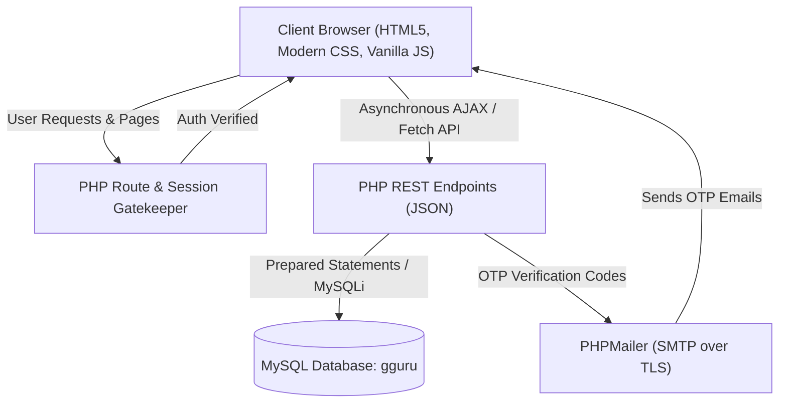

# 📱 Gadget Guru (gguru)

> **Gadget Guru** is a comprehensive, full-stack smartphone exploration, comparison, and discovery platform built with PHP, MySQL, Vanilla JavaScript, and modern Dark Glassmorphism CSS. It empowers users to research smartphones, run granular multi-attribute searches, compare device specs side-by-side, view curated rankings, save phones to their personal wishlist, and manage user accounts and phone inventories through an administrative control center.

---

## 📑 Table of Contents

1. [Overview & System Architecture](#-overview--system-architecture)
2. [Technology Stack](#-technology-stack)
3. [Database Design & Schema](#-database-design--schema)
4. [How It Works (Core Workflows)](#-how-it-works-core-workflows)
   - [Authentication & Two-Factor OTP Security](#1-authentication--two-factor-otp-security)
   - [Smart Discovery & Multi-Facet Filtering Engine](#2-smart-discovery--multi-facet-filtering-engine)
   - [Curated Recommendation Algorithms](#3-curated-recommendation-algorithms)
   - [Side-by-Side Comparison Engine](#4-side-by-side-comparison-engine)
   - [User Wishlist & Slide-Out Profile Management](#5-user-wishlist--slide-out-profile-management)
   - [Administrative Control Panel & Analytics](#6-administrative-control-panel--analytics)
5. [Directory & File Structure](#-directory--file-structure)
6. [API & Backend Endpoint Reference](#-api--backend-endpoint-reference)
7. [Installation & Setup Guide](#-installation--setup-guide)
8. [Security Features & Best Practices](#-security-features--best-practices)

---

## 🏛 Overview & System Architecture

Gadget Guru is built with a decoupled client-server pattern using PHP as a REST-like JSON API and server-side session validator, coupled with an asynchronous Vanilla JavaScript frontend:



---

## 🛠 Technology Stack

### Frontend
- **Markup & Layout**: Semantic **HTML5**, CSS Grid, Flexbox.
- **Styling & UI**: Custom **CSS3** utilizing CSS Custom Properties (Variables), Dark Mode theme, Glassmorphism (`backdrop-filter: blur()`), keyframe animations, and responsive media queries.
- **Scripting**: Pure **Vanilla JavaScript (ES6+)**:
  - Asynchronous `Fetch API` with Promise chaining and error handling.
  - Live debouncing for search inputs and dynamic autocomplete suggestions.
  - Client-side pagination (20 items/page).
  - DOM manipulation and dynamic modal rendering.
- **Icons & Typography**:
  - [Font Awesome 6 (Free CDN)](https://fontawesome.com/)
  - [Google Fonts](https://fonts.google.com/): *Poppins* (body text) & *Roboto* (headings).
- **Data Visualization**:
  - [Chart.js (v4+)](https://www.chartjs.org/) for administrative visual metrics and doughnut charts.

### Backend
- **Core Language**: **PHP 7.4+ / 8.x** (Procedural & Object-Oriented).
- **Database Driver**: **MySQLi** (`mysqli` with Prepared Statements and parameter binding).
- **Session Management**: Native PHP Sessions (`$_SESSION`) with anti-caching HTTP response headers (`Cache-Control: no-store, no-cache`, `Pragma: no-cache`).
- **Authentication & Cryptography**: Native `password_hash()` and `password_verify()` using modern bcrypt algorithms.
- **Mailing Service**: [PHPMailer](https://github.com/PHPMailer/PHPMailer) integrated via Composer autoloading for Gmail SMTP (TLS port 587).

### Database
- **Database Engine**: **MySQL / MariaDB** (Default database: `gguru`, charset: `utf8mb4`).
- **Tables**: `users`, `smartphones`, `wishlist`.

---

## 🗄 Database Design & Schema

### 1. `users` Table
Stores registered member and administrator credentials, account statuses, and OTP tokens.

| Column | Type | Attributes | Description |
|---|---|---|---|
| `uid` | INT | PRIMARY KEY, AUTO_INCREMENT | Unique user identifier |
| `username` | VARCHAR(100) | NOT NULL | Display username |
| `email` | VARCHAR(255) | NOT NULL, UNIQUE | User email address (login credential) |
| `password` | VARCHAR(255) | NOT NULL | Hashed password (`PASSWORD_DEFAULT` bcrypt) |
| `role` | VARCHAR(20) | DEFAULT 'user' | Access level: `'user'` or `'admin'` |
| `otp` | INT(6) / VARCHAR(6) | NULLABLE | 6-digit one-time verification passcode |
| `is_verified` | TINYINT(1) | DEFAULT 0 | `0` = pending email verification, `1` = verified |
| `status` | TINYINT(1) | DEFAULT 0 | Account access status: `0` = Active, `1` = Suspended/Blocked |

### 2. `smartphones` Table
Comprehensive repository storing full technical specifications, multimedia links, and dimensions for every cataloged smartphone.

| Column | Type | Category | Description |
|---|---|---|---|
| `phone_id` | INT | Key | Primary key, auto increment |
| `brand_name` | VARCHAR(100) | Identity | Phone manufacturer (Apple, Samsung, etc.) |
| `model_name` | VARCHAR(150) | Identity | Specific phone model name |
| `release_date` | DATE / VARCHAR | Identity | Official launch/release date |
| `price` | DECIMAL(10,2) | Commercial | Market price in INR / local currency |
| `image_url` | VARCHAR(2083) | Media | Direct URL to phone image render |
| `youtube_link` | VARCHAR(2083) | Media | Video review / showcase URL |
| `height_mm`, `width_mm`, `thickness_mm` | DECIMAL(6,2) | Body | Physical dimensions in millimeters |
| `weight_g` | DECIMAL(6,2) | Body | Weight in grams |
| `sim_slot`, `sim_type` | VARCHAR(50) | SIM | Dual SIM, Nano-SIM, eSIM capabilities |
| `network_support` | VARCHAR(50) | Network | 5G, 4G LTE, VoLTE network support |
| `display_type` | VARCHAR(100) | Display | AMOLED, Super Retina XDR, IPS LCD |
| `screen_size_in` | DECIMAL(4,2) | Display | Diagonal screen size in inches |
| `resolution` | VARCHAR(50) | Display | Screen resolution (e.g. 1080 x 2400) |
| `refresh_rate_hz` | INT | Display | Refresh rate in Hertz (60Hz, 90Hz, 120Hz) |
| `aspect_ratio` | VARCHAR(20) | Display | Aspect ratio (e.g. 20:9, 19.5:9) |
| `processor` | VARCHAR(150) | Hardware | CPU model (e.g., Octa-core Snapdragon 8 Gen 2) |
| `chipset` | VARCHAR(150) | Hardware | Chipset platform |
| `ram_gb` | INT | Hardware | RAM capacity in Gigabytes |
| `storage_gb` | INT | Hardware | Internal storage capacity in Gigabytes |
| `battery_mah` | INT | Battery | Battery capacity in milliampere-hours |
| `fast_charging_w` | INT | Battery | Fast charging speed in Watts |
| `os`, `os_update`, `ui` | VARCHAR(100) | Software | OS name, promised OS version, custom skin/UI |
| `rear_camera` | TEXT / VARCHAR | Camera | Rear camera sensor specs (e.g., 200MP + 12MP + 10MP) |
| `front_camera` | TEXT / VARCHAR | Camera | Selfie camera specifications |
| `fingerprint_sensor` | VARCHAR(50) | Security | In-display, side-mounted, rear sensor |

### 3. `wishlist` Table
Relational junction table connecting users to saved smartphones.

| Column | Type | Attributes | Description |
|---|---|---|---|
| `id` | INT | PRIMARY KEY, AUTO_INCREMENT | Entry ID |
| `uid` | INT | FOREIGN KEY (`users.uid`) | ID of the saving user |
| `phone_id` | INT | FOREIGN KEY (`smartphones.phone_id`) | ID of the bookmarked phone |

---

## ⚙ How It Works (Core Workflows)

### 1. Authentication & Two-Factor OTP Security
1. **Registration (`signup.html` & `signup-process.php`)**:
   - The user supplies a username, email, and password.
   - Client and server validate username format, email syntax, and strict password complexity (min 8 characters, 1 uppercase, 1 digit, 1 special character).
   - A random 6-digit cryptographic OTP is generated and saved with the new user record (`is_verified = 0`).
   - PHPMailer delivers an HTML verification email via Google SMTP.
2. **Account Verification (`verify-otp.php`)**:
   - The user inputs the 6-digit OTP received via email.
   - Upon verification, the user status transitions to `is_verified = 1`, the OTP token is cleared, and an active session is immediately initialized.
3. **Login (`login.php` & `login-process.php`)**:
   - Verifies credentials via `password_verify()`.
   - Rejects unverified accounts (`is_verified = 0`) and suspended accounts (`status = 1`).
   - Sets session variables (`$_SESSION['uid']`, `$_SESSION['username']`, `$_SESSION['role']`).
   - Routes role `'admin'` directly to `admin-d.php` and role `'user'` to `shome.php`.
4. **Password Reset (`forgot-password.php`, `process-reset-code.php`, `reset-password.php`)**:
   - Generates an OTP code sent to the registered email.
   - Requires verification before exposing the password reset input form.

---

### 2. Smart Discovery & Multi-Facet Filtering Engine
Located on `shome.php` and powered by `filter.php` and `filters.php`:
- **Real-Time Autocomplete**: As the user types in the search bar, `phone_suggestions.php` queries matching phone combinations using `CONCAT(brand_name, ' ', model_name)`.
- **Dynamic Filter Modal**: Users can filter phone inventories using:
  - Brand selection (Apple, Samsung, OnePlus, Xiaomi, etc.)
  - Price slider & manual min/max boundaries
  - Operating System (Android, iOS)
  - Processor families
  - Hardware specs: RAM (4GB, 6GB, 8GB, 12GB+), Storage (64GB, 128GB, 256GB, 512GB+)
  - Battery capacity (4000mAh+, 5000mAh+) and charging speeds
  - Screen refresh rate (90Hz, 120Hz, 144Hz)
- **Parameterized SQL Construction**: `filter.php` dynamically builds prepared query clauses with SQL placeholders (`?`), guaranteeing injection resistance.
- **Client-Side Pagination**: Phones are partitioned into batches of 20 per view with clean previous/next controls.

---

### 3. Curated Recommendation Algorithms

Gadget Guru features three algorithmic showcase categories:

#### A. Best Value Phones (`bvp.php` / `get_best_value_phones.php`)
Calculates a hardware score divided by the device price:
$$\text{Value Score} = \frac{\text{RAM Tier} + \text{Storage Tier} + \text{Battery Tier} + \text{Refresh Rate Tier}}{\text{Price}}$$

- **RAM**: $\ge 12\text{GB} \to 4\text{ pts}$, $\ge 8\text{GB} \to 3\text{ pts}$, $\ge 6\text{GB} \to 2\text{ pts}$, else $1\text{ pt}$.
- **Storage**: $\ge 512\text{GB} \to 4\text{ pts}$, $\ge 256\text{GB} \to 3\text{ pts}$, $\ge 128\text{GB} \to 2\text{ pts}$, else $1\text{ pt}$.
- **Battery**: $\ge 5000\text{mAh} \to 3\text{ pts}$, $\ge 4000\text{mAh} \to 2\text{ pts}$, else $1\text{ pt}$.
- **Refresh Rate**: $\ge 120\text{Hz} \to 3\text{ pts}$, $\ge 90\text{Hz} \to 2\text{ pts}$, else $1\text{ pt}$.

#### B. Top Rated Phones (`trp.php` / `get_top_rated_phones.php`)
Ranks smartphones by sheer hardware performance score based on top-tier components, using `release_date` as a tie-breaker.

#### C. Camera Kings (`bcp.php` / `get_best_camera_phones.php`)
Extracts the primary sensor megapixel count from text using SQL:
`CAST(SUBSTRING_INDEX(rear_camera, ' ', 1) AS UNSIGNED) AS primary_camera_mp`
and displays devices with high-resolution photographic setups.

---

### 4. Side-by-Side Comparison Engine
Located in `compare.php` and `fetch_comparison.php`:
- Dual autocomplete input boxes allow users to select any two smartphones.
- `fetch_comparison.php` retrieves flat specifications for both models.
- The interface builds a high-density, row-by-row matrix comparing:
  - Display size, panel type, resolution, and refresh rate.
  - Processor, RAM, storage, and battery specifications.
  - Camera systems (front and rear).
  - Physical form factor, weight, and network standards.
  - Direct video showcase link and pricing breakdown.

---

### 5. User Wishlist & Slide-Out Profile Management
- **Wishlist Toggle (`add_wishlist.php`)**: An asynchronous toggle mechanism. If an item is already bookmarked by the user, it is removed; otherwise, it is inserted into the `wishlist` table.
- **Wishlist View (`w.php`)**: Dedicated collection page displaying all devices saved by the user with one-click removal and direct links to full detail pages.
- **Slide-Out Profile Sidebar (`sidebars.php`)**:
  - Glassmorphic slide-out navigation panel accessible from the top navbar.
  - Live AJAX-based username modification (`change_username.php`).
  - Secure in-panel password updates (`change_password.php`).
  - Email address change requests with OTP re-verification (`change_email_request.php` & `change_email_verify.php`).

---

### 6. Administrative Control Panel & Analytics
Located in `admin-d.php` (restricted to `role = 'admin'`):
- **Live Metrics**: Real-time counter cards showing total registered users and total smartphones in inventory via `dashboard_counts.php`.
- **Chart.js Brand Analytics**: Visualizes brand market share and catalog breakdown using dynamic data retrieved from `get_brand_distribution.php`.
- **User Management**:
  - Displays all registered accounts via `get_users.php`.
  - Instant one-click user suspension/unblocking via `toggle_user_status.php`.
- **Inventory Management**:
  - **Create Phone (`add_phone.php`)**: Complete modal form capturing over 30 specifications.
  - **Edit Phone (`editphone.php` & `get_single_phone.php`)**: Pre-populates existing data and commits updates.
  - **Delete Phone (`delete_phone.php`)**: Removes unwanted records with confirmation dialogs.

---

## 📁 Directory & File Structure

```
gguru/
│
├── config.php                      # Database connection setup (MySQLi, UTF-8)
├── mail-config.php                 # PHPMailer SMTP credentials & host configuration
│
├── landing.html                    # Public landing page with features showcase & hero section
├── login.php                       # User login interface
├── login-process.php               # Login verification & role routing logic
├── logout.php                      # Session destruction and redirection script
├── signup.html                     # Account creation form with interactive validation
├── signup-process.php              # Account registration, validation, & OTP dispatch
├── send-otp.php                    # Standalone OTP dispatch endpoint
├── verify-otp.php                  # Registration OTP verification endpoint
├── forgot-password.php             # Password recovery initiation screen
├── process-reset-code.php          # Password reset OTP generation & dispatch
├── reset-password.php              # New password entry screen
├── reset-process.php               # Password update verification & commit
├── verify-reset-code.php           # OTP verification for password reset
│
├── shome.php                       # Main authenticated user discovery hub & catalog
├── detail.php                      # Full technical spec sheet view for a single phone
├── compare.php                     # Side-by-side device comparison interface
├── filters.php                     # Search filter modal & input controls partial
├── sidebars.php                    # Slide-out user profile & account management sidebar
├── footer.php                      # Global footer navigation and brand info
│
├── w.php                           # User's personal saved wishlist page
├── add_wishlist.php                # AJAX endpoint to toggle items in user wishlist
│
├── bcp.php                         # Best Camera Phones showcase page
├── bvp.php                         # Best Value Phones showcase page
├── trp.php                         # Top Rated Phones showcase page
│
├── filter.php                      # Core AJAX search & multi-attribute filter endpoint
├── phone_suggestions.php           # Instant autocomplete query endpoint
├── fetch_comparison.php            # Dual phone spec retrieval endpoint for comparison
├── get_all_phone_data.php          # Full catalog retrieval endpoint
├── get_best_camera_phones.php      # Camera Kings ranking query endpoint
├── get_best_value_phones.php       # Best Value algorithmic query endpoint
├── get_top_rated_phones.php        # Hardware performance ranking query endpoint
├── get_phone.php                   # Single phone data fetch
├── get_single_phone.php            # Edit form single phone data fetch
│
├── admin-d.php                     # Full administrative dashboard & control center
├── dashboard_counts.php            # Admin counter metrics API (users, phones count)
├── get_brand_distribution.php      # Admin brand distribution chart API
├── get_users.php                   # Admin user list retrieval API
├── toggle_user_status.php          # Admin block/unblock user toggle endpoint
├── add_phone.php                   # Admin insert new smartphone endpoint
├── editphone.php                   # Admin update smartphone specifications endpoint
├── delete_phone.php                # Admin delete smartphone endpoint
│
├── change_username.php             # Profile update: username modification
├── change_password.php             # Profile update: password modification
├── change_email_request.php        # Profile update: email change request & OTP sender
├── change_email_verify.php         # Profile update: email change verification & commit
│
├── assets/                         # Static images and project assets
│   ├── image.png
│   └── 0f9b870a14c7e5ae215834cf9393b0cd.jpg
│
└── vendor/                         # Composer dependencies (PHPMailer)
    ├── autoload.php
    └── phpmailer/
```

---

## 🔌 API & Backend Endpoint Reference

| Endpoint | HTTP Method | Expected Payload / Params | Response Format | Purpose |
|---|---|---|---|---|
| `login-process.php` | `POST` | `email`, `password` | JSON | Authenticates user & returns redirect path |
| `signup-process.php` | `POST` | `username`, `email`, `password`, `confirm` | JSON | Validates, registers user, sends verification OTP |
| `verify-otp.php` | `POST` | `email`, `otp` | JSON | Verifies email and activates user account |
| `filter.php` | `POST` | JSON: `{ search, price, brands, os, ram, ... }` | JSON (Array) | Dynamic multi-attribute filtered phone search |
| `phone_suggestions.php`| `GET` | `query` (string) | JSON (Array) | Autocomplete brand and model suggestions |
| `fetch_comparison.php` | `GET` | `id1`, `id2` OR `brand1`, `model1`, `brand2`, `model2` | JSON | Retrieves specifications for two comparison phones |
| `add_wishlist.php` | `POST` | `phone_id` | JSON | Toggles (adds/removes) phone in user's wishlist |
| `get_best_value_phones.php` | `GET` | None | JSON (Array) | Top 20 smartphones sorted by value score |
| `get_best_camera_phones.php`| `GET` | None | JSON (Array) | Top 20 smartphones sorted by camera MP |
| `get_top_rated_phones.php` | `GET` | None | JSON (Array) | Top 20 smartphones sorted by performance score |
| `dashboard_counts.php`| `GET` | Session (Admin/Auth) | JSON | Returns `{ total_users, total_phones }` |
| `get_brand_distribution.php`| `GET` | Session (Admin) | JSON | Returns brand labels and unit counts for Chart.js |
| `get_users.php` | `GET` | Session (Admin) | JSON (Array) | Returns all user rows (`uid`, `email`, `status`, etc.) |
| `toggle_user_status.php`| `POST` | `uid` (integer) | JSON | Inverts account status (0 = Active, 1 = Suspended) |
| `add_phone.php` | `POST` | JSON (Full phone specs object) | JSON | Inserts a new smartphone into the catalog |
| `editphone.php` | `POST` | JSON (Full phone specs + `phone_id`) | JSON | Updates existing smartphone specifications |
| `delete_phone.php` | `GET` | `phone_id` (integer) | JSON | Removes a smartphone record from database |

---

## 🚀 Installation & Setup Guide

### Prerequisites
- **Local Web Server**: [XAMPP](https://www.apachefriends.org/), [WampServer](https://www.wampserver.com/), or [Laragon](https://laragon.org/) with **PHP 7.4+** and **MySQL / MariaDB**.
- **Composer** (optional, PHPMailer is already bundled inside `/vendor`).

### 1. Project Placement
Clone or move the project folder into your web server's public root:
- For XAMPP: `C:/xampp/htdocs/gguru`
- For Laragon: `C:/laragon/www/gguru`

### 2. Database Creation & Configuration
1. Start your **Apache** and **MySQL** services in your local server control panel.
2. Open **phpMyAdmin** (`http://localhost/phpmyadmin`).
3. Create a new database named `gguru` with collation `utf8mb4_unicode_ci`.
4. Run the following SQL queries to initialize the necessary tables:

```sql
CREATE DATABASE IF NOT EXISTS `gguru` DEFAULT CHARACTER SET utf8mb4 COLLATE utf8mb4_unicode_ci;
USE `gguru`;

-- 1. Users Table
CREATE TABLE IF NOT EXISTS `users` (
  `uid` int(11) NOT NULL AUTO_INCREMENT,
  `username` varchar(100) NOT NULL,
  `email` varchar(255) NOT NULL UNIQUE,
  `password` varchar(255) NOT NULL,
  `role` varchar(20) DEFAULT 'user',
  `otp` int(6) DEFAULT NULL,
  `is_verified` tinyint(1) DEFAULT 0,
  `status` tinyint(1) DEFAULT 0,
  PRIMARY KEY (`uid`)
) ENGINE=InnoDB DEFAULT CHARSET=utf8mb4;

-- 2. Smartphones Table
CREATE TABLE IF NOT EXISTS `smartphones` (
  `phone_id` int(11) NOT NULL AUTO_INCREMENT,
  `brand_name` varchar(100) NOT NULL,
  `model_name` varchar(150) NOT NULL,
  `release_date` date DEFAULT NULL,
  `price` decimal(10,2) NOT NULL DEFAULT 0.00,
  `image_url` text DEFAULT NULL,
  `youtube_link` text DEFAULT NULL,
  `height_mm` decimal(6,2) DEFAULT NULL,
  `width_mm` decimal(6,2) DEFAULT NULL,
  `thickness_mm` decimal(6,2) DEFAULT NULL,
  `weight_g` decimal(6,2) DEFAULT NULL,
  `sim_slot` varchar(50) DEFAULT NULL,
  `sim_type` varchar(50) DEFAULT NULL,
  `network_support` varchar(50) DEFAULT NULL,
  `display_type` varchar(100) DEFAULT NULL,
  `screen_size_in` decimal(4,2) DEFAULT NULL,
  `resolution` varchar(50) DEFAULT NULL,
  `refresh_rate_hz` int(11) DEFAULT NULL,
  `aspect_ratio` varchar(20) DEFAULT NULL,
  `processor` varchar(150) DEFAULT NULL,
  `chipset` varchar(150) DEFAULT NULL,
  `ram_gb` int(11) DEFAULT NULL,
  `storage_gb` int(11) DEFAULT NULL,
  `battery_mah` int(11) DEFAULT NULL,
  `fast_charging_w` int(11) DEFAULT NULL,
  `os` varchar(100) DEFAULT NULL,
  `os_update` varchar(100) DEFAULT NULL,
  `ui` varchar(100) DEFAULT NULL,
  `rear_camera` text DEFAULT NULL,
  `front_camera` text DEFAULT NULL,
  `fingerprint_sensor` varchar(50) DEFAULT NULL,
  PRIMARY KEY (`phone_id`)
) ENGINE=InnoDB DEFAULT CHARSET=utf8mb4;

-- 3. Wishlist Table
CREATE TABLE IF NOT EXISTS `wishlist` (
  `id` int(11) NOT NULL AUTO_INCREMENT,
  `uid` int(11) NOT NULL,
  `phone_id` int(11) NOT NULL,
  PRIMARY KEY (`id`),
  KEY `fk_wishlist_user` (`uid`),
  KEY `fk_wishlist_phone` (`phone_id`),
  CONSTRAINT `fk_wishlist_user` FOREIGN KEY (`uid`) REFERENCES `users` (`uid`) ON DELETE CASCADE,
  CONSTRAINT `fk_wishlist_phone` FOREIGN KEY (`phone_id`) REFERENCES `smartphones` (`phone_id`) ON DELETE CASCADE
) ENGINE=InnoDB DEFAULT CHARSET=utf8mb4;
```

5. Verify your database connection settings in [config.php](file:///c:/Users/acvas/OneDrive/Documents/project/gguru/config.php):
```php
$host    = 'localhost';
$db_user = 'root';
$db_pass = '';
$db_name = 'gguru';
```

### 3. Email & SMTP Configuration
Configure your outgoing mail parameters in [mail-config.php](file:///c:/Users/acvas/OneDrive/Documents/project/gguru/mail-config.php):
```php
define('MAIL_HOST', 'smtp.gmail.com');
define('MAIL_USERNAME', 'your-email@gmail.com');
define('MAIL_PASSWORD', 'your-google-app-password'); // 16-character Google App Password
define('MAIL_ENCRYPTION', 'tls');
define('MAIL_PORT', 587);
```

### 4. Running the Application
Open your web browser and navigate to:
```
http://localhost/gguru/landing.html
```

---

## 🔒 Security Features & Best Practices

1. **SQL Injection Defense**: Prepared statements with parameterized type-binding (`$stmt->bind_param()`) are used across database writes, queries, and dynamic filters.
2. **Password Cryptography**: Passwords are saved using standard cryptographic hashes via `password_hash($password, PASSWORD_DEFAULT)` and verified with timing-safe `password_verify()`.
3. **Session Hardening & Back-Button Shielding**: Protected pages feature HTTP cache control headers (`no-store`, `no-cache`, `must-revalidate`, `max-age=0`) to ensure browser history navigation cannot expose authenticated session views post-logout.
4. **Role-Based Gatekeeping**:
   - `admin-d.php` checks both `$_SESSION['uid']` and `$_SESSION['role'] === 'admin'`.
   - Admin-only JSON endpoints reject unauthorized users with HTTP `401 Unauthorized`.
5. **Account Suspension Verification**: Blocked users (`status = 1`) are denied entry upon authentication.
6. **Input Sanitization**: Email formats are validated with `filter_var(..., FILTER_VALIDATE_EMAIL)`, numeric identifiers with `FILTER_VALIDATE_INT`, and text inputs with `htmlspecialchars()` during HTML output.
# Gadget-Guru

